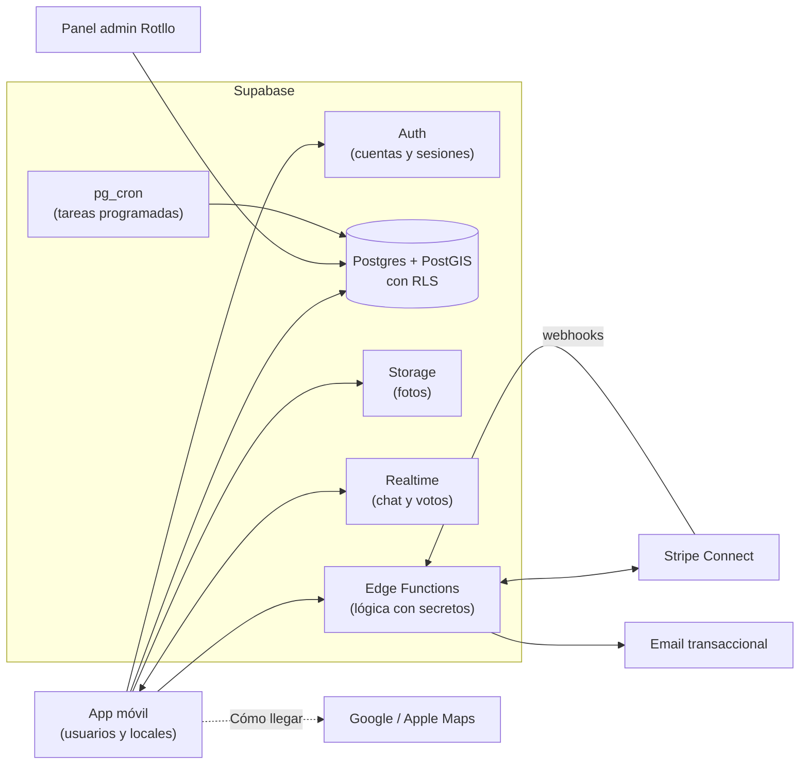
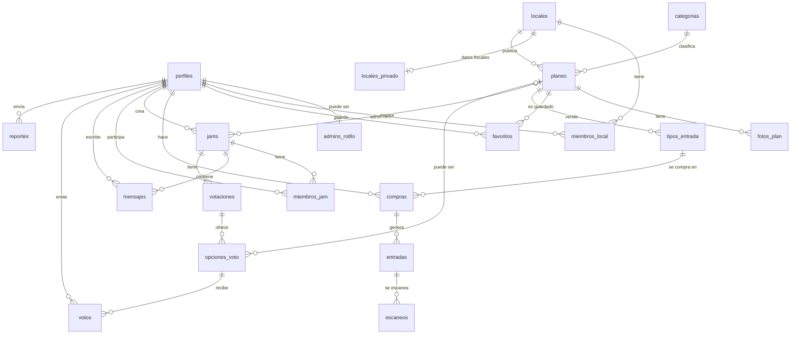
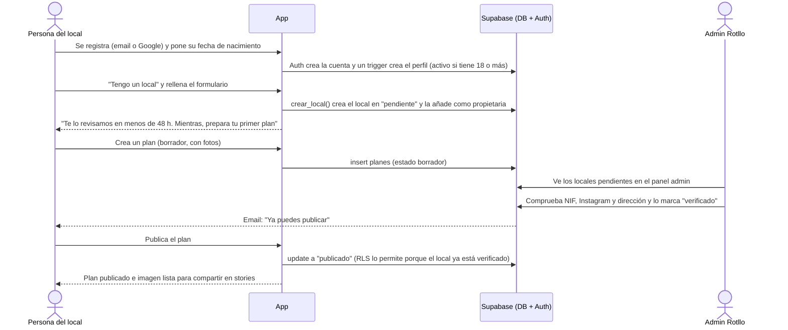
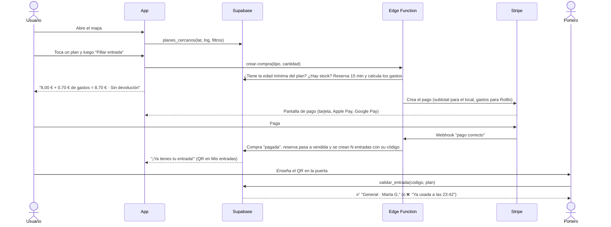
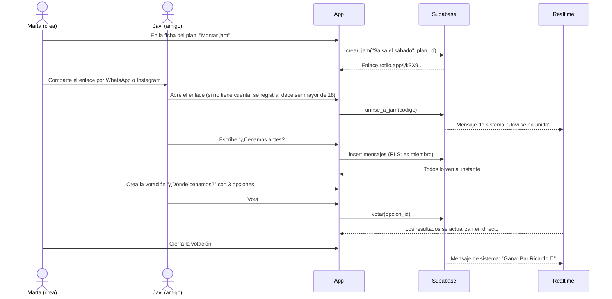

# Rotllo · Diseño del sistema (MVP)

> Estado: **propuesta para revisar**. Fecha: 2026-11-07 (actualizado con las decisiones sobre entradas, edad, gastos de gestión y devoluciones).
> Se basa en `CLAUDE.md` y en las decisiones de la sección 0. La sección "Stack" de `CLAUDE.md` sigue vacía: aquí se propone Supabase + Stripe, pero se confirma en la Fase 1.

## Índice

0. [Decisiones tomadas y fases](#0-decisiones-tomadas-y-fases)
1. [Visión general](#1-visión-general)
2. [Entidades y relaciones](#2-entidades-y-relaciones)
3. [Roles y permisos (RLS)](#3-roles-y-permisos-rls)
4. [Flujos principales](#4-flujos-principales)
5. [Casos límite](#5-casos-límite)
6. [Fuera del MVP](#6-fuera-del-mvp)
7. [Preguntas abiertas](#7-preguntas-abiertas)
8. [Qué revisar cuando crezcamos](#8-qué-revisar-cuando-crezcamos)

---

## 0. Decisiones tomadas y fases

| Tema | Decisión | En sencillo |
|---|---|---|
| Alcance | Se diseña todo ahora y se construye por fases | Las tablas ya piensan en entradas y jam, aunque en v1 no se usen. Así no hay que rehacer la base de datos después. |
| Pagos | Stripe Connect: el dinero va al local y Rotllo se queda los gastos de gestión | Cada local conecta su cuenta de Stripe. Cuando alguien paga, Stripe le da el dinero al local y separa automáticamente la parte de Rotllo. |
| Edad mínima | **Rotllo es para mayores de 18** | Al registrarse se pide la fecha de nacimiento y, si no tiene 18, no puede crear la cuenta. Sin cuenta se pueden mirar los planes, pero no guardar, comprar ni entrar en jams. |
| Edad por plan | **Cada local define la suya** | La app es para todo el público adulto, sin límite superior. Cada local decide en sus planes la **edad mínima de acceso** (18, 21, 25...) y, si quiere, el **público al que apunta** (por ejemplo, 25-40). La edad mínima se respeta al comprar y en la puerta. El público objetivo es solo orientativo: no oculta el plan a nadie. |
| Comprobar la edad | Fecha de nacimiento declarada + DNI en la puerta | La app confía en la fecha que pone el usuario; el control real lo hace el local en la puerta, pidiendo el DNI como siempre. |
| Comisión | **La paga el comprador** como "gastos de gestión": **5 % + 0,30 € por entrada** | Se suma al precio: una entrada de 8 € paga 0,70 € de gastos y en total 8,70 €. El local recibe sus 8 € enteros. |
| Planes gratis | **Sin gastos** | Si el plan es gratis y tiene aforo, se reserva la entrada en la app gratis del todo: sin gastos y sin pasar por Stripe. |
| Devoluciones | **Sin devolución, salvo que el local la active** en su plan | Por defecto, una entrada comprada no se devuelve. Cada local puede activar "Admite devoluciones hasta X horas antes" en un plan. Si el plan se cancela, se devuelve todo siempre. |
| Jam | Estilo Spotify Jam: grupo privado por enlace de invitación, **máximo 30 personas** | Alguien crea una jam (normalmente desde un plan), comparte el enlace con sus amigos y ahí chatean y votan. No es una sala pública. |
| Idiomas | **Español, inglés e italiano** | La app sale en español y queda preparada para inglés e italiano. El valenciano no se traduce, aunque el tono de marca sigue teniendo su toque valenciano ("vinga", barrios...). |
| Categorías | **Lista cerrada**, mantenida por Rotllo | Rotllo decide la lista y cada local elige una al crear un plan. Así los filtros no se llenan de duplicados ("Fiesta", "fiesta", "Party") y cada categoría ya viene traducida. Son 9 (ver tabla `categorias`). |
| Orden de v2 | **Primero entradas, luego jam** | Las entradas traen ingresos y es lo que piden los locales. La jam vale más cuando ya hay usuarios. |

**Fases** (cada tabla y cada flujo lleva su etiqueta):

1. **v1**: perfiles, locales, verificación, planes, fotos, categorías, feed y mapa, favoritos, reportes, entradas como enlace a la ticketera del local, imagen para stories.
2. **v2 · entradas**: venta dentro de la app, Stripe Connect, gastos de gestión, QR, escaneo en la puerta y devoluciones opcionales.
3. **v2 · jam** (después de entradas): jams por invitación, chat en tiempo real y votaciones.

---

## 1. Visión general



En sencillo, cada pieza hace esto:

- **Postgres** es la base de datos: ahí viven los planes, usuarios, entradas...
- **PostGIS** es una extensión de Postgres que sabe de mapas: permite preguntar "planes a menos de 2 km de mí".
- **RLS (Row Level Security)** son reglas dentro de la base de datos que deciden qué filas puede ver o cambiar cada persona. Aunque alguien manipule la app, la base de datos no le deja saltarse las reglas.
- **Edge Functions** son pequeños programas en el servidor. Se usan para lo que necesita secretos (la clave de Stripe) o lo que no se puede dejar en manos del móvil (crear entradas, cobrar, devolver dinero).
- **Realtime** avisa a la app al instante cuando llega un mensaje o un voto nuevo.
- **pg_cron** ejecuta tareas cada cierto tiempo, como liberar las entradas reservadas que no se pagaron.

**Regla de oro**: la app puede leer casi todo lo público directamente, pero **todo lo que toca dinero o entradas pasa por una Edge Function o por una función SQL** controlada. La app nunca escribe directamente "esta compra está pagada".

**Escala esperada**: al principio, Valencia, de cientos a pocos miles de usuarios activos y decenas de locales. Un proyecto Supabase normal (plan Pro) aguanta esto de sobra. No hace falta caché, colas ni microservicios.

---

## 2. Entidades y relaciones

### 2.1 Diagrama



Cómo se lee: `||--o{` significa "uno a muchos" (un local tiene muchos planes); `|o--o{` significa que el lado de la izquierda es opcional (una jam puede tener un plan asociado o no tenerlo).

### 2.2 Convenciones

- **Ids**: `uuid` generados por la base de datos.
- **Fechas**: `timestamptz` (guardan la zona horaria). En la app se muestran en hora de Madrid.
- **Dinero**: siempre en **céntimos** y como número entero (`800` = 8,00 €). Así se evitan errores de redondeo con decimales.
- **Estados**: tipos `enum` de Postgres, que solo admiten los valores de la lista.
- **Textos de categorías**: `jsonb` con las claves `es`, `en` e `it`, para que el inglés y el italiano no necesiten columnas nuevas (y añadir otro idioma más adelante tampoco).
- Todas las tablas tienen `creado_en timestamptz default now()`. Las que se editan tienen además `actualizado_en`.

### 2.3 Tablas

#### Usuarios · v1

**`perfiles`**: un perfil por cada cuenta de `auth.users`, la tabla de cuentas que gestiona Supabase Auth.

| Campo | Tipo | Notas |
|---|---|---|
| `id` | uuid PK | Es el mismo id de `auth.users`. |
| `username` | text único | Para mencionar y buscar. Entre 3 y 20 caracteres. |
| `nombre_visible` | text | El nombre que ven los demás. |
| `avatar_url` | text | Ruta en Storage. |
| `fecha_nacimiento` | date | **Privada y obligatoria.** Regla en la base de datos: tiene que dar 18 años o más. Una vez puesta, solo se cambia a través de soporte. |
| `idioma` | enum `es`/`en`/`it` | Por defecto `es`. |
| `estado` | enum `incompleto`/`activo`/`suspendido` | `incompleto`: acaba de registrarse (por ejemplo, con Google) y aún no ha puesto su fecha de nacimiento; hasta entonces no puede hacer nada. `suspendido`: puede leer pero no escribir. |
| `creado_en`, `actualizado_en` | timestamptz | |

Además, la vista **`perfiles_publicos`** (`id`, `username`, `nombre_visible`, `avatar_url`) es lo que ven los demás. Así nunca se expone la fecha de nacimiento.

**`admins_rotllo`**: el equipo de Rotllo.

| Campo | Tipo | Notas |
|---|---|---|
| `user_id` | uuid PK → perfiles | |
| `creado_en` | timestamptz | |

Va en una tabla aparte, y no como una columna `es_admin` en `perfiles`, para que nadie pueda hacerse admin editando su propio perfil.

#### Locales · v1

**`locales`**: la parte pública del local.

| Campo | Tipo | Notas |
|---|---|---|
| `id` | uuid PK | |
| `nombre` | text | |
| `slug` | text único | Para la URL: `rotllo.app/l/cafe-mercedes`. |
| `tipo` | enum `bar`/`discoteca`/`actividad`/`cultura`/`otro` | |
| `descripcion` | text | |
| `direccion` | text | |
| `barrio` | text | Russafa, el Carmen, Benimaclet... |
| `edad_minima_defecto` | int | Por defecto, 18; nunca menos. Es la edad que se propone al crear cada plan nuevo de este local. |
| `ubicacion` | geography(Point) | Para el mapa (PostGIS). |
| `instagram`, `web`, `telefono` | text | Opcionales. |
| `logo_url`, `portada_url` | text | Storage. |
| `estado_verificacion` | enum `pendiente`/`verificado`/`rechazado`/`suspendido` | Solo los locales `verificado` pueden publicar. |
| `motivo_rechazo` | text | Se rellena si se rechaza o se suspende. |
| `verificado_en`, `verificado_por` | timestamptz, uuid → perfiles | Qué admin lo verificó y cuándo. |
| `stripe_account_id` | text | **v2 · entradas.** La cuenta conectada del local. |
| `stripe_listo` | bool | **v2 · entradas.** `true` cuando Stripe confirma que el local puede cobrar. |
| `creado_por` | uuid → perfiles | |
| `creado_en`, `actualizado_en` | timestamptz | |

**`locales_privado`**: los datos que no deben ser públicos.

| Campo | Tipo | Notas |
|---|---|---|
| `local_id` | uuid PK → locales | |
| `razon_social` | text | |
| `nif` | text | CIF o NIF. |
| `email_contacto`, `telefono_contacto` | text | Para que Rotllo pueda contactar con el local. |
| `notas_verificacion` | text | Notas internas del admin. |

**`miembros_local`**: las personas que administran un local. Un local puede tener varias y una persona puede llevar varios locales.

| Campo | Tipo | Notas |
|---|---|---|
| `local_id` | uuid → locales | PK compuesta (`local_id`, `user_id`). |
| `user_id` | uuid → perfiles | |
| `rol` | enum `propietario`/`editor`/`portero` | El propietario gestiona miembros y pagos. El editor crea y edita planes. El portero solo escanea entradas. |
| `creado_en` | timestamptz | |

#### Planes · v1

**`categorias`**

| Campo | Tipo | Notas |
|---|---|---|
| `id` | uuid PK | |
| `slug` | text único | `fiesta`, `musica-en-directo`, `deporte`, `cultura`, `gastro`, `taller`... |
| `nombre` | jsonb | `{"es": "Fiesta", "en": "Party", "it": "Festa"}` |
| `icono` | text | Nombre del icono. |
| `orden` | int | Orden de los filtros. |
| `activa` | bool | Permite ocultar una categoría sin borrarla. |

Lista inicial (cerrada: solo la cambia un admin de Rotllo):

| es | en | it | Ejemplos |
|---|---|---|---|
| Fiesta | Party | Festa | Discotecas, DJ, sesiones |
| Música en directo | Live music | Musica dal vivo | Conciertos, jam sessions, jazz |
| Bar y tardeo | Bars & afternoon | Bar e aperitivo | Afterwork, vermut, terrazas |
| Gastro | Food & drink | Gastronomia | Catas, esmorzarets, cenas temáticas |
| Cultura | Culture | Cultura | Teatro, cine, expos, monólogos |
| Deporte | Sports | Sport | Running, pádel, vóley en la playa |
| Talleres | Workshops | Laboratori | Cerámica, cócteles, baile |
| Social | Meet people | Conoscere gente | Intercambios de idiomas, quedadas, juegos de mesa |
| Aire libre | Outdoors | All'aperto | Planes en la playa, el Turia, excursiones |

Las traducciones al inglés y al italiano son una primera propuesta: conviene que las revise alguien nativo.

**`planes`**

| Campo | Tipo | Notas |
|---|---|---|
| `id` | uuid PK | |
| `local_id` | uuid → locales | |
| `categoria_id` | uuid → categorias | |
| `titulo` | text | Máximo 80 caracteres. |
| `descripcion` | text | |
| `idioma` | enum `es`/`en`/`it` | El idioma en el que lo escribió el local. |
| `empieza_en`, `termina_en` | timestamptz | `termina_en` es opcional. |
| `ubicacion` | geography(Point) | Por defecto, la del local. Se puede cambiar si el plan es en otro sitio. |
| `direccion` | text | Ídem. |
| `es_gratis` | bool | |
| `precio_desde_centimos` | int | Lo que se muestra en el feed ("Desde 8 €"). |
| `edad_minima` | int | Edad mínima de acceso. Por defecto, la del local; nunca menos de 18 (regla en la base de datos). Se muestra como "+18", "+21"... Si es mayor de 18, la app no deja comprar a quien no la tenga **el día del plan**. |
| `publico_edad_desde`, `publico_edad_hasta` | int, opcionales | El público al que apunta el local (por ejemplo, 25-40). Es orientativo: se muestra en la ficha ("Ambiente 25-40") y servirá para un filtro, pero no impide ver ni comprar. |
| `modo_entradas` | enum `ninguna`/`enlace_externo`/`rotllo` | En v1 solo `ninguna` o `enlace_externo`. `rotllo` es **v2 · entradas**. |
| `url_ticketera` | text | Si `modo_entradas = enlace_externo`. |
| `admite_devoluciones` | bool | **v2 · entradas.** Por defecto `false`. |
| `devoluciones_hasta_horas` | int | **v2 · entradas.** Por ejemplo, `24`: se puede devolver hasta 24 h antes de empezar. Solo si `admite_devoluciones`. |
| `estado` | enum `borrador`/`publicado`/`cancelado`/`finalizado` | Ver casos límite. |
| `motivo_cancelacion` | text | |
| `publicado_en`, `cancelado_en` | timestamptz | |
| `creado_por` | uuid → perfiles | |
| `creado_en`, `actualizado_en` | timestamptz | |

Tiene índices por `ubicacion` (de tipo GIST, para el mapa), por `empieza_en` y por (`estado`, `empieza_en`).

**`fotos_plan`**

| Campo | Tipo | Notas |
|---|---|---|
| `id` | uuid PK | |
| `plan_id` | uuid → planes | |
| `storage_path` | text | |
| `texto_alternativo` | text | Para la accesibilidad. |
| `orden` | int | La 0 es la portada y también se usa para la imagen de stories. |

**`favoritos`**

| Campo | Tipo | Notas |
|---|---|---|
| `user_id` | uuid → perfiles | PK compuesta (`user_id`, `plan_id`). |
| `plan_id` | uuid → planes | |
| `creado_en` | timestamptz | |

#### Entradas · v2 · entradas

Funciona en tres niveles: **tipo de entrada** (el producto y su stock), **compra** (el pago) y **entrada** (cada QR individual). Si compras 3 entradas, hay 1 compra y 3 entradas, cada una con su QR, para que cada amigo entre con la suya.

**`tipos_entrada`**

| Campo | Tipo | Notas |
|---|---|---|
| `id` | uuid PK | |
| `plan_id` | uuid → planes | |
| `nombre` | text | "General", "Anticipada", "Con copa"... |
| `precio_centimos` | int | |
| `cantidad_total` | int | El aforo de este tipo. |
| `cantidad_reservada` | int | Entradas apartadas mientras alguien está pagando. |
| `cantidad_vendida` | int | |
| `max_por_compra` | int | Por defecto, 6. |
| `venta_desde`, `venta_hasta` | timestamptz | |
| `activo` | bool | |

Tiene una regla fija en la base de datos: `cantidad_reservada + cantidad_vendida <= cantidad_total`. Así, aunque dos personas compren a la vez la última entrada, nunca se vende más de la cuenta.

**`compras`**

| Campo | Tipo | Notas |
|---|---|---|
| `id` | uuid PK | |
| `user_id` | uuid → perfiles | |
| `plan_id` | uuid → planes | Repetido aquí para que las consultas sean más simples. |
| `tipo_entrada_id` | uuid → tipos_entrada | En el MVP, un solo tipo de entrada por compra. |
| `cantidad` | int | |
| `precio_unitario_centimos` | int | Se guarda el precio del momento de la compra, por si el local lo cambia después. |
| `subtotal_centimos` | int | `precio_unitario × cantidad`. Es lo que recibe el local. |
| `gastos_gestion_centimos` | int | Lo que paga el comprador a Rotllo por comprar en la app. |
| `total_centimos` | int | `subtotal + gastos_gestion`. Es lo que se cobra en la tarjeta. |
| `estado` | enum `pendiente`/`pagada`/`fallida`/`expirada`/`reembolsada` | |
| `motivo_reembolso` | enum `plan_cancelado`/`devolucion_usuario`/`otro` | |
| `importe_reembolsado_centimos` | int | Si se cancela el plan, el total. Si es una devolución que pide el usuario, solo el subtotal (ver casos límite). |
| `reserva_expira_en` | timestamptz | Momento en que se liberan las entradas si no se ha pagado (15 min después de empezar la compra). |
| `stripe_payment_intent_id` | text único | |
| `pagada_en`, `reembolsada_en` | timestamptz | |
| `creado_en` | timestamptz | |

**`entradas`**

| Campo | Tipo | Notas |
|---|---|---|
| `id` | uuid PK | |
| `compra_id` | uuid → compras | |
| `plan_id` | uuid → planes | |
| `tipo_entrada_id` | uuid → tipos_entrada | |
| `titular_id` | uuid → perfiles | Al principio es quien compra. Pasar la entrada a un amigo queda fuera del MVP. |
| `codigo` | text único | Un código aleatorio largo (unos 22 caracteres) y **sin datos personales**. Es lo que lleva el QR. |
| `estado` | enum `valida`/`usada`/`anulada` | |
| `usada_en` | timestamptz | |
| `validada_por` | uuid → perfiles | El portero que la escaneó. |
| `creado_en` | timestamptz | |

**`escaneos`**: un registro de cada intento de escaneo, para resolver dudas en la puerta ("yo no he entrado").

| Campo | Tipo | Notas |
|---|---|---|
| `id` | uuid PK | |
| `codigo_leido` | text | |
| `entrada_id` | uuid → entradas, opcional | Queda vacío si el código no existe. |
| `plan_id` | uuid → planes | El plan para el que se estaba escaneando. |
| `escaneado_por` | uuid → perfiles | |
| `resultado` | enum `ok`/`ya_usada`/`anulada`/`no_existe`/`otro_plan` | |
| `creado_en` | timestamptz | |

**`tarifas_gestion`**: cómo se calculan los gastos de gestión. Así el importe se cambia sin tocar código y cada compra guarda lo que se aplicó en su momento.

| Campo | Tipo | Notas |
|---|---|---|
| `id` | uuid PK | |
| `porcentaje` | numeric | Ahora `5` (= 5 % del subtotal). |
| `fijo_centimos` | int | Ahora `30` (= 0,30 € por entrada). |
| `vigente_desde` | timestamptz | Se usa la tarifa más reciente. |

**`eventos_stripe`**: guarda los avisos que manda Stripe para no procesar el mismo dos veces (Stripe a veces los repite).

| Campo | Tipo | Notas |
|---|---|---|
| `id` | text PK | El id del evento de Stripe. |
| `tipo` | text | |
| `procesado_en` | timestamptz | |

#### Jam · v2 · jam

Como en Spotify: una jam es un **grupo privado**. Se entra con el enlace de invitación y sin enlace no se ve. Puede ir ligada a un plan ("Jam: Noche de salsa") o no tener ninguno ("¿Qué hacemos el finde?").

**`jams`**

| Campo | Tipo | Notas |
|---|---|---|
| `id` | uuid PK | |
| `creada_por` | uuid → perfiles | |
| `titulo` | text | Por defecto, el título del plan. |
| `plan_id` | uuid → planes, opcional | |
| `codigo_invitacion` | text único | Aleatorio. Forma el enlace `rotllo.app/j/<codigo>`. |
| `invitacion_activa` | bool | El creador puede desactivar el enlace o cambiarlo por uno nuevo. |
| `max_miembros` | int | 30. |
| `estado` | enum `activa`/`archivada` | Se archiva sola 7 días después del plan, o tras 30 días sin mensajes. |
| `creado_en` | timestamptz | |

**`miembros_jam`**

| Campo | Tipo | Notas |
|---|---|---|
| `jam_id` | uuid → jams | PK compuesta (`jam_id`, `user_id`). |
| `user_id` | uuid → perfiles | |
| `rol` | enum `creador`/`miembro` | |
| `estado` | enum `activo`/`expulsado` | Un expulsado no puede volver a entrar ni con el enlace. |
| `unido_en` | timestamptz | |

**`mensajes`**

| Campo | Tipo | Notas |
|---|---|---|
| `id` | uuid PK | |
| `jam_id` | uuid → jams | |
| `user_id` | uuid → perfiles, opcional | Vacío en los mensajes del sistema ("Marta se ha unido"). |
| `tipo` | enum `texto`/`plan`/`sistema` | `plan` sirve para compartir un plan dentro del chat. |
| `contenido` | text | Máximo 1000 caracteres. |
| `plan_id` | uuid → planes, opcional | Si `tipo = plan`. |
| `oculto` | bool | Lo oculta la moderación o se oculta solo tras varios reportes. |
| `borrado_en` | timestamptz | El autor lo borró. Se muestra "Mensaje borrado". |
| `creado_en` | timestamptz | |

**`votaciones`**

| Campo | Tipo | Notas |
|---|---|---|
| `id` | uuid PK | |
| `jam_id` | uuid → jams | |
| `creada_por` | uuid → perfiles | |
| `pregunta` | text | "¿A dónde vamos el viernes?" |
| `multiple` | bool | Si se puede votar más de una opción. |
| `cierra_en` | timestamptz, opcional | |
| `estado` | enum `abierta`/`cerrada` | |
| `creado_en` | timestamptz | |

**`opciones_voto`**

| Campo | Tipo | Notas |
|---|---|---|
| `id` | uuid PK | |
| `votacion_id` | uuid → votaciones | |
| `texto` | text | |
| `plan_id` | uuid → planes, opcional | Permite votar entre planes de Rotllo con tarjeta y todo. |
| `orden` | int | |

**`votos`**

| Campo | Tipo | Notas |
|---|---|---|
| `votacion_id` | uuid → votaciones | |
| `opcion_id` | uuid → opciones_voto | PK compuesta (`opcion_id`, `user_id`). |
| `user_id` | uuid → perfiles | |
| `creado_en` | timestamptz | |

Si la votación no es múltiple, la función `votar()` borra el voto anterior de esa persona antes de guardar el nuevo. Así, cambiar de opinión es un solo toque.

#### Moderación · v1 (se amplía en v2 · jam)

**`reportes`**

| Campo | Tipo | Notas |
|---|---|---|
| `id` | uuid PK | |
| `reportado_por` | uuid → perfiles | |
| `tipo_objetivo` | enum `plan`/`local`/`usuario`/`mensaje`/`jam` | |
| `objetivo_id` | uuid | El id de lo que se reporta. |
| `motivo` | enum `spam`/`acoso`/`inapropiado`/`fraude`/`menores`/`otro` | |
| `detalle` | text, opcional | |
| `estado` | enum `pendiente`/`accion_tomada`/`descartado` | |
| `revisado_por`, `revisado_en` | uuid, timestamptz | |
| `resolucion` | text | Qué se hizo. |
| `creado_en` | timestamptz | |

No se puede reportar dos veces lo mismo: hay una regla única sobre (`reportado_por`, `tipo_objetivo`, `objetivo_id`).

---

## 3. Roles y permisos (RLS)

### 3.1 Los cuatro roles

| Rol | Quién es | Cómo lo sabe la base de datos |
|---|---|---|
| **Anónimo** | Alguien sin cuenta. | No hay sesión (`auth.uid()` es nulo). |
| **Usuario** | Alguien con cuenta. Siempre mayor de 18 (declarado). | `auth.uid()` tiene valor y su perfil está `activo`. |
| **Local** | Un usuario que además está en `miembros_local` de un local. | Función `es_miembro_local(local_id, roles)`. |
| **Admin Rotllo** | El equipo de Rotllo. | Función `es_admin()`, que mira `admins_rotllo`. |

"Local" no es otro tipo de cuenta: **es un usuario con permisos extra sobre un local concreto**. La misma persona puede salir de fiesta como usuario y gestionar su bar como local.

Las funciones de ayuda (`es_admin()`, `es_miembro_local()`, `es_miembro_jam()`) se crean en SQL y se usan dentro de las reglas. Así las reglas quedan cortas y legibles.

### 3.2 Qué puede hacer cada uno (resumen)

| Acción | Anónimo | Usuario | Local | Admin |
|---|---|---|---|---|
| Ver planes publicados, fotos, categorías y perfil público de locales verificados | ✅ | ✅ | ✅ | ✅ |
| Usar mapa, filtros y "Cómo llegar" | ✅ | ✅ | ✅ | ✅ |
| Guardar favoritos | ❌ | ✅ los suyos | ✅ | ✅ |
| Editar su perfil | ❌ | ✅ el suyo | ✅ | ✅ cualquiera |
| Reportar contenido | ❌ | ✅ | ✅ | ✅ |
| Comprar entradas · v2 | ❌ (se le pide entrar) | ✅ si tiene la edad mínima del plan | ✅ | ✅ |
| Pedir devolución · v2 | ❌ | ✅ si el plan la admite y está en plazo | ✅ | ✅ |
| Activar devoluciones en un plan · v2 | ❌ | ❌ | ✅ editor/propietario | ✅ |
| Ver sus entradas y su QR · v2 | ❌ | ✅ solo las suyas | ✅ | ✅ |
| Crear jam, unirse con enlace, chatear y votar · v2 | ❌ | ✅ solo en sus jams | ✅ | Solo para moderar |
| Registrar un local | ❌ | ✅ (queda `pendiente`) | — | ✅ |
| Fijar edad mínima y público de sus planes | ❌ | ❌ | ✅ editor/propietario | ✅ |
| Crear y editar planes en borrador | ❌ | ❌ | ✅ editor/propietario | ✅ |
| Publicar planes | ❌ | ❌ | ✅ solo si el local está `verificado` | ✅ |
| Cancelar un plan | ❌ | ❌ | ✅ editor/propietario | ✅ |
| Ver ventas de su plan · v2 | ❌ | ❌ | ✅ propietario/editor | ✅ |
| Escanear entradas · v2 | ❌ | ❌ | ✅ cualquier rol del local | ✅ |
| Gestionar miembros del local y la cuenta de Stripe | ❌ | ❌ | ✅ solo propietario | ✅ |
| Verificar, rechazar o suspender locales | ❌ | ❌ | ❌ | ✅ |
| Revisar reportes, ocultar mensajes, suspender usuarios | ❌ | ❌ | ❌ | ✅ |

### 3.3 Reglas por tabla

En RLS hay cuatro operaciones: **select** (leer), **insert** (crear), **update** (cambiar) y **delete** (borrar). Si no hay ninguna regla que lo permita, está prohibido. Por eso solo hay que listar lo que sí se permite.

El admin puede leer y cambiar todo en todas las tablas (`es_admin()`). No se repite en cada tabla.

| Tabla | select | insert | update | delete |
|---|---|---|---|---|
| `perfiles` | Uno mismo. Los demás usan la vista `perfiles_publicos`. | Lo crea un trigger al registrarse (en `incompleto`). | Uno mismo. Puede poner `fecha_nacimiento` una vez (y entonces pasa a `activo` si tiene 18 o más). No puede cambiar `estado` por su cuenta. | Nadie. Borrar la cuenta va por una función. |
| `admins_rotllo` | Solo admin | Solo admin | — | Solo admin |
| `locales` | Todos, si está `verificado`. Sus miembros, siempre. | Usuario, mediante `crear_local()` | Propietario y editor: sus datos. Nunca `estado_verificacion` ni `stripe_*`. | Nadie (se suspende) |
| `locales_privado` | Propietario del local | Mediante `crear_local()` | Propietario | — |
| `miembros_local` | Miembros de ese local | Propietario de ese local | Propietario | Propietario (sin quitar al último propietario) |
| `categorias` | Todos | Admin | Admin | Admin |
| `planes` | Todos, si `estado` ≠ `borrador` y el local está verificado. Los miembros del local ven también sus borradores. | Editor o propietario del local | Editor o propietario. Solo puede pasar a `publicado` si el local está `verificado`. | Editor o propietario, solo en `borrador` |
| `fotos_plan` | Igual que su plan | Editor o propietario | Editor o propietario | Editor o propietario |
| `favoritos` | Uno mismo | Uno mismo | — | Uno mismo |
| `tipos_entrada` · v2 | Todos, si el plan es visible | Editor o propietario | Editor o propietario. Sin bajar `cantidad_total` por debajo de lo vendido. | Solo si no hay ventas |
| `compras` · v2 | El comprador. Propietario y editor del local de ese plan. | **Nadie desde la app**: solo la Edge Function `crear-compra`. | Solo las Edge Functions | — |
| `entradas` · v2 | El titular. Miembros del local de ese plan. | Solo la Edge Function del webhook | Solo mediante `validar_entrada()` o al cancelar | — |
| `escaneos` · v2 | Miembros del local | Mediante `validar_entrada()` | — | — |
| `tarifas_gestion` · v2 | Todos | Admin | Admin | — |
| `eventos_stripe` · v2 | Solo servidor | Solo servidor | — | — |
| `jams` · v2 | Miembros activos | Usuario, mediante `crear_jam()` | Creador (título, enlace) | Creador |
| `miembros_jam` · v2 | Miembros de esa jam | Mediante `unirse_a_jam(codigo)` | Creador (expulsar) | Uno mismo (salir) |
| `mensajes` · v2 | Miembros activos de esa jam (los ocultos no se muestran) | Miembro activo y no suspendido, con `user_id = auth.uid()` | El autor (para borrar) | — |
| `votaciones`, `opciones_voto` · v2 | Miembros de la jam | Miembro activo | Quien la creó (cerrarla) | Quien la creó, si no tiene votos |
| `votos` · v2 | Miembros de la jam | Mediante `votar()`, si la votación está `abierta` | — | Uno mismo |
| `reportes` | Quien lo envió (solo el suyo) | Usuario activo | Admin | — |

Ejemplo de cómo se escribe una de estas reglas en SQL (los planes visibles para todos):

```sql
create policy "planes visibles"
on planes for select
using (
  (estado <> 'borrador'
    and exists (select 1 from locales l
                where l.id = planes.local_id
                  and l.estado_verificacion = 'verificado'))
  or es_miembro_local(planes.local_id, array['propietario','editor','portero'])
  or es_admin()
);
```

En sencillo: "puedes ver un plan si no es un borrador y su local está verificado, o si eres de ese local, o si eres admin".

### 3.4 Funciones con lógica (RPC y Edge Functions)

Algunas acciones son demasiado delicadas para una regla simple: tienen que hacer varias cosas a la vez o tocar dinero. Van en funciones.

| Función | Dónde | Qué hace |
|---|---|---|
| `crear_local(datos)` | SQL | Crea el local en `pendiente` y su fila en `locales_privado`, y te añade como `propietario`. Todo de una vez. |
| `planes_cercanos(lat, lng, radio, filtros)` | SQL | Busca para el mapa y el feed. Filtros: hoy, este finde, categoría, gratis/pago, distancia. |
| `crear-compra` · v2 | Edge Function | Comprueba el stock, reserva las entradas, calcula los gastos de gestión y crea el pago en Stripe. |
| `solicitar-devolucion` · v2 | Edge Function | Comprueba que el plan admite devoluciones, que está en plazo y que ninguna entrada se ha usado. Devuelve el subtotal, anula las entradas y libera el stock. |
| `stripe-webhook` · v2 | Edge Function | Recibe "pago correcto" o "pago fallido" de Stripe y crea o libera las entradas. |
| `conectar-stripe` · v2 | Edge Function | Genera el enlace para que el local dé de alta su cuenta en Stripe. |
| `cancelar-plan` · v2 | Edge Function | Cancela el plan, anula las entradas, devuelve el dinero y avisa a los compradores. |
| `validar_entrada(codigo, plan_id)` · v2 | SQL | Marca la entrada como usada **una sola vez** (ver flujo 2). |
| `crear_jam(titulo, plan_id)` · v2 | SQL | Crea la jam con su código y te pone de `creador`. |
| `unirse_a_jam(codigo)` · v2 | SQL | Comprueba el código, el límite de miembros y que no estés expulsado, y te añade. |
| `nuevo_enlace_jam(jam_id)` · v2 | SQL | Cambia el código: el enlace viejo deja de funcionar. |
| `votar(opcion_id)` · v2 | SQL | Guarda el voto (y quita el anterior si la votación no es múltiple). |

---

## 4. Flujos principales

### Flujo 1 · Un local se registra, es verificado y publica su primer plan (v1)



Paso a paso:

1. **Registro**: la persona crea su cuenta como cualquier usuario, con su fecha de nacimiento (tiene que ser mayor de 18).
2. **Alta del local**: en "Tengo un local" rellena nombre, tipo, dirección (se marca en el mapa), Instagram, NIF, un email de contacto y la edad mínima habitual de su local (18 por defecto). La función `crear_local()` lo guarda todo junto, con el local en `pendiente`.
3. **Mientras espera**: ya puede preparar planes en borrador, añadir fotos e invitar a su equipo (editores y porteros). Lo que no puede es publicar.
4. **Verificación (manual en el MVP)**: un admin de Rotllo revisa en su panel que el local existe: NIF, Instagram, Google Maps y, si hace falta, una llamada. Lo marca `verificado`, o `rechazado` con un motivo.
5. **Aviso** por email, porque las notificaciones push llegan más tarde.
6. **Publicar**: el plan pasa a `publicado` y aparece en el feed y en el mapa.
7. **Promoción**: se genera una imagen con la foto de portada, el título, la fecha y el enlace `rotllo.app/p/<id>`, lista para Instagram stories.
8. **Solo v2 · entradas**: para vender dentro de la app, el propietario pulsa "Cobrar con Rotllo" y hace el alta en Stripe (identidad, IBAN). Cuando Stripe lo aprueba, `stripe_listo` pasa a `true` y ya puede crear tipos de entrada. Hasta entonces, puede usar un enlace a su ticketera.

### Flujo 2 · Un usuario encuentra un plan, compra una entrada y entra con QR (v2 · entradas)



Paso a paso:

1. **Descubrir**: el mapa llama a `planes_cercanos()` con la ubicación (si la persona la comparte) y los filtros. Funciona sin cuenta.
2. **Ficha**: fotos, descripción, "Cómo llegar" (abre Google o Apple Maps) y "Pillar entrada".
3. **Cuenta**: si no ha iniciado sesión, se le pide entrar o registrarse, y luego vuelve a la ficha.
4. **Resumen antes de pagar**: precio de la entrada, gastos de gestión, total y condiciones de devolución ("Sin devolución" o "Puedes devolverla hasta 24 h antes"). La ley de consumo obliga a mostrar el precio total con todos los gastos **antes** de pagar. Además, para que no haya sorpresas, propongo que la ficha ya diga "8 € + gastos".
5. **Edad**: si el plan pide más de 18 (por ejemplo, +21), se comprueba con la fecha de nacimiento y la edad que tendrá **el día del plan**. Si no llega, se ve "Este plan es +21" y no puede comprar.
6. **Reserva**: `crear-compra` aparta las entradas durante 15 minutos con una operación atómica. "Atómica" significa que no se puede quedar a medias: o se reservan todas o ninguna, aunque cien personas compren a la vez.
7. **Pago**: Stripe cobra el total, envía el subtotal a la cuenta del local y deja los gastos de gestión a Rotllo (`application_fee`). Ojo: Stripe cobra su propia comisión por cada pago (en torno al 1,5 % + 0,25 € con tarjetas europeas) y, con este modelo, **sale de la parte de Rotllo**. Por eso los gastos de gestión tienen que cubrir al menos esa cantidad.
8. **Confirmación**: la app **no** decide si el pago ha ido bien. Lo decide el aviso (webhook) que Stripe manda al servidor. Así nadie puede "fingir" un pago desde el móvil.
9. **Entradas**: se crea una entrada con su código aleatorio por cada unidad comprada. La app las guarda en el móvil para poder enseñarlas sin cobertura. Se envía un email de confirmación.
10. **Puerta**: el portero abre "Escanear" en la app (con su rol `portero`) y lee el QR. `validar_entrada()` ejecuta una sola orden:

   ```sql
   update entradas
      set estado = 'usada', usada_en = now(), validada_por = auth.uid()
    where codigo = $1 and plan_id = $2 and estado = 'valida'
   returning *;
   ```

   Si devuelve una fila, es ✅ y el portero ve el tipo de entrada, el nombre del titular y la edad mínima del plan ("+21"). Si no devuelve nada, es que ya estaba usada o anulada, o que el código no existe o es de otro plan: ❌ con el motivo. Cada intento queda apuntado en `escaneos`.
11. **DNI**: el portero pide el DNI y lo compara con el nombre y la edad mínima del plan.
12. **Devolución (solo si el local la activó)**: en "Mis entradas" aparece "Devolver" mientras se esté en plazo. `solicitar-devolucion` devuelve el precio de las entradas (los gastos de gestión no se devuelven), anula las entradas y las vuelve a poner a la venta. En el MVP se devuelve la compra entera, no entradas sueltas.

**Si el plan es gratis con aforo**: los pasos 7 y 8 no existen. `crear-compra` ve que el total es 0 €, marca la compra como pagada y crea las entradas al momento, sin Stripe y sin gastos. La entrada y el QR funcionan igual en la puerta.

### Flujo 3 · Un usuario entra en la jam de un plan, chatea y vota (v2 · jam)



Paso a paso:

1. **Crear**: desde la ficha de un plan ("Montar jam") o desde la pestaña Jam ("Nueva jam"). `crear_jam()` genera un código difícil de adivinar.
2. **Compartir**: el enlace `rotllo.app/j/<codigo>` se envía por WhatsApp, Instagram, etc. Si quien lo abre no tiene la app, va a la web o la tienda y, después de registrarse, vuelve a la jam.
3. **Unirse**: `unirse_a_jam(codigo)` comprueba que el enlace está activo, que la jam no está llena (30) y que esa persona no fue expulsada.
4. **Chatear**: cada mensaje se guarda en `mensajes`. Realtime lo envía a los demás miembros. Las reglas RLS se aplican también aquí: solo lo reciben los miembros.
5. **Votar**: cualquiera crea una votación con 2-6 opciones, que pueden ser texto o planes de Rotllo. Votar con `votar()` permite cambiar de opinión. Los resultados se ven en directo.
6. **Cerrar**: la cierra quien la creó, o se cierra sola en `cierra_en`. Un mensaje del sistema anuncia lo que ha ganado.
7. **Fin**: 7 días después del plan, la jam se archiva y queda en solo lectura.

---

## 5. Casos límite

| Caso | Qué pasa | Cómo se resuelve |
|---|---|---|
| **Entradas agotadas** (v2) | Dos personas van a por la última entrada a la vez. | La reserva es atómica y la regla `reservada + vendida <= total` impide vender de más: la segunda persona ve "Agotadas". Cada minuto, `pg_cron` libera las reservas caducadas, así que una entrada que alguien dejó a medias vuelve a estar disponible. Si Stripe confirma un pago cuando la reserva ya había caducado y no queda stock (muy raro), se devuelve el dinero automáticamente y se avisa. En la ficha se ve "Últimas entradas" cuando queda menos del 10 %. |
| **Pago fallido** (v2) | La tarjeta es rechazada, el usuario cierra la app a medias o Stripe tarda. | La compra queda `fallida` o `expirada` y se liberan las entradas. No se crea ninguna entrada hasta que Stripe confirma. Si el usuario cierra la app, el webhook termina el trabajo igualmente. Mientras tanto, la app muestra "Estamos confirmando tu pago". Los webhooks se apuntan en `eventos_stripe` para no procesar el mismo dos veces. |
| **Plan cancelado** | El local cancela, o lo hace un admin (por ejemplo, por fraude). | El plan pasa a `cancelado` con un motivo (no se borra). En el feed desaparece, pero la ficha sigue accesible con la etiqueta "Cancelado". **v2:** las entradas pasan a `anuladas` y todas las compras se devuelven por Stripe **completas, gastos de gestión incluidos** (la persona no tiene culpa), con un email a cada comprador. En ese caso Rotllo pierde la comisión de Stripe de esos pagos. Las jams ligadas reciben un mensaje del sistema. Un plan cancelado no se puede volver a publicar: se crea uno nuevo. Los cambios de fecha u hora se tratan como cancelación más plan nuevo en el MVP. |
| **Doble escaneo de QR** (v2) | Alguien hace captura y la pasa a un amigo, o el portero escanea dos veces. | `validar_entrada()` solo cambia la entrada si sigue `valida`, en una sola operación. Gana el primero y el segundo ve ❌ "Ya usada a las 23:42". El portero ve el nombre del titular para compararlo con el DNI. Todo queda apuntado en `escaneos`. En el MVP el escaneo necesita conexión. |
| **Spam o acoso en el chat** (v2) | Alguien molesta en una jam. | Como las jams son privadas, el riesgo ya es menor. Además: límite de 10 mensajes cada 30 segundos y 1000 caracteres; el creador puede **expulsar** (quien es expulsado no puede volver ni con el enlace) y **cambiar el enlace**; cualquiera puede salir o **reportar** un mensaje. Con 3 reportes de personas distintas, el mensaje se oculta hasta que lo revise un admin. Un admin puede suspender a un usuario, y entonces RLS le bloquea escribir en todas partes. |
| **Menores o gente por debajo de la edad del plan** | Un menor intenta usar la app, o alguien de 19 años quiere ir a un plan +21. | **En la app**: no se puede crear una cuenta con menos de 18 años (regla en la base de datos sobre `fecha_nacimiento`). Al comprar, se compara la edad del día del plan con la `edad_minima` del plan. La fecha de nacimiento solo se pone una vez, para que no se pueda "probar otra". Si alguien miente, cualquiera puede reportarlo con el motivo `menores` y un admin suspende la cuenta. **En la puerta**: el escaneo muestra la edad mínima y el nombre del titular, y el portero pide el DNI. Esa es la comprobación de verdad; la app no la sustituye. |
| **Devolución pedida por el usuario** (v2) | Alguien compró y ya no puede ir. | Por defecto, **sin devolución**. Se avisa claramente antes de pagar y en la entrada. Si el local activó devoluciones en ese plan, se puede devolver hasta X horas antes, siempre que ninguna entrada de la compra se haya usado. Se devuelve el precio de las entradas, pero **no los gastos de gestión**. Las entradas devueltas vuelven a estar a la venta. Nota legal: en España, el derecho de desistimiento de 14 días no se aplica a entradas de ocio con fecha concreta, así que "sin devolución" es válido. Conviene confirmarlo con un asesor antes de lanzar. |

Otros casos que conviene tener presentes:

- **Un local suspendido**: sus planes dejan de verse (RLS), y en v2 se paran sus ventas. Las entradas ya vendidas siguen siendo válidas salvo que se cancele el plan.
- **Un plan que ya ha pasado**: un trabajo de `pg_cron` lo marca `finalizado` cuando termina, o 6 horas después de empezar si no tiene hora de fin. Sale del feed.
- **Borrar la cuenta (RGPD)**: se anonimiza el perfil. Las compras se conservan por obligación fiscal, pero sin datos personales visibles, y los mensajes pasan a mostrar "Usuario eliminado".

---

## 6. Fuera del MVP

Para lanzar rápido, esto **no** entra en v1 ni en la primera versión de v2:

- **Jam por zona o barrio** y jams públicas. Solo hay jams privadas por enlace.
- **Notificaciones push**. Se usa email para lo importante: verificación, compra, cancelación.
- **Transferir o revender entradas** entre usuarios.
- **Lista de espera** cuando se agotan las entradas.
- **Códigos de descuento**, entradas por fases automáticas y abonos.
- **Varios tipos de entrada en una misma compra** (en el MVP, uno por compra).
- **Devolver solo parte de una compra** (en el MVP, la compra entera).
- **Escaneo sin conexión** en la puerta.
- **QR que cambia cada pocos segundos** para evitar capturas.
- **Verificación de DNI dentro de la app.**
- **Verificación automática de locales**: es manual, por un admin.
- **Bloquear a un usuario** a nivel global (en el MVP: expulsar de la jam, salir y reportar).
- **Fotos, audios o GIFs en el chat**: solo texto y planes compartidos.
- **Reseñas y valoraciones** de planes o locales.
- **Planes que se repiten** ("todos los jueves"): en el MVP se duplica el plan.
- **Estadísticas avanzadas para locales**: en el MVP, solo entradas vendidas y escaneadas.
- **Traducción automática** de los planes: cada local escribe en su idioma.
- **Recomendaciones personalizadas**: el feed se ordena por fecha y distancia.
- **Login con Apple o TikTok, perfiles sociales y seguidores.**

---

## 7. Preguntas abiertas

No queda ninguna. Todo lo que estaba pendiente está decidido en la sección 0.

## 8. Qué revisar cuando crezcamos

- **Moderación**: si los reportes crecen, añadir filtros automáticos de insultos o enlaces y un panel de moderación con prioridades.
- **Picos de venta** (una fiesta muy esperada que sale a la venta a las 12:00): la reserva atómica aguanta, pero habría que añadir una cola de espera y límites por usuario.
- **Mapa**: con miles de planes, agrupar los puntos (clustering) y cachear las búsquedas por zona.
- **Chat**: si una jam tiene mucha actividad, cargar los mensajes por páginas y borrar los de jams archivadas tras X meses.
- **Fraude con entradas**: QR dinámico y transferencia nominal si aparece la reventa.
- **Otras ciudades**: hoy todo da por hecho que estamos en Valencia (zona horaria, barrios). Si Rotllo sale de Valencia, añadir una tabla `ciudades` y un `ciudad_id` en locales y planes.
